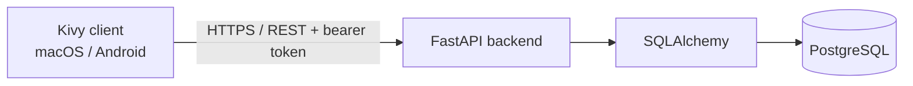

# CampusFix

**Campus complaint and service-request management system** built with a Python Kivy client, a FastAPI backend, and PostgreSQL.

CampusFix provides separate workflows for **Students**, **Staff**, and **Admins**, so a campus issue can be reported, assigned, worked on, and tracked through its lifecycle.

> **Project status:** Academic prototype. Automated tests passed locally (62/62, November 2026). The Android build and backend deployment require separate environment setup.

## Features

| Role | Main capabilities |
| --- | --- |
| **Student** | Register/sign in, create complaints, browse personal complaints and status, view updates and notifications, and request reopening where supported |
| **Staff** | Access assigned complaints, update progress/status, and work with complaint details |
| **Admin** | View complaint overview, assign staff, and access administrative insights |

Additional functionality includes comments, complaint status history, notifications, role-based authorization, and reopen requests.

## Architecture



The client and backend are **separate processes**. The Android APK is a client; it does not contain or host the PostgreSQL database or FastAPI server.

## Tech stack

- **Client:** Python, Kivy, Requests
- **API:** Python, FastAPI, Pydantic, Uvicorn
- **Persistence:** PostgreSQL, SQLAlchemy, Psycopg
- **Authentication:** role-based authorization, password hashing, bearer tokens
- **Testing:** pytest, FastAPI TestClient / HTTPX
- **Android:** Buildozer / python-for-android (packaging configuration under `android_staging/`)

## Project structure

```text
campus_fix/
├── backend/
│   ├── main.py                 # FastAPI app, database engine, router registration
│   ├── models/                 # SQLAlchemy database models
│   ├── routes/                 # Authentication, complaints, staff/admin flows, etc.
│   ├── schemas/                # Reserved package
│   └── setup_*.py              # Database setup/migration helper scripts
├── frontend/
│   ├── main.py                 # Current Kivy application and UI workflows
│   ├── components/             # Reserved package
│   ├── screens/                # Reserved package
│   └── services/               # Reserved package
├── tests/                      # Automated API and workflow regression tests
├── scripts/                    # Dependency and Android preparation utilities
├── requirements/               # Backend, client, development dependencies
├── android_staging/            # Android client source and Buildozer config
├── design_lab/                 # UI design experiment / preview
├── requirements.txt           # Combined local development dependencies
└── .gitignore                  # Secrets, caches and build exclusions
```

**Note:** The Kivy screens are primarily implemented in `frontend/main.py`; the `screens/`, `components/`, and `services/` directories are currently placeholders, not fully separated modules.

## Run locally (macOS)

**Prerequisites:** Python environment, PostgreSQL with a locally configured `campusfix` database and `campusfix_app` account, and an untracked `.env` containing your local credentials. Never commit `.env`.

```bash
# In the repository root
python3 -m venv .venv
source .venv/bin/activate
python -m pip install -r requirements.txt
```

The backend reads `CAMPUSFIX_DB_PASSWORD` and `CAMPUSFIX_AUTH_SECRET` from environment variables. Configure them locally; see the existing setup utilities in `backend/`. In particular, `python -m backend.setup_auth_key` can help set up the authentication secret. The PostgreSQL role and database must already be provisioned.

**Terminal 1 — API server**

```bash
source .venv/bin/activate
python -m uvicorn backend.main:app --host 127.0.0.1 --port 8000 --env-file .env
```

**Terminal 2 — Kivy client**

```bash
source .venv/bin/activate
python -m frontend.main
```

**Verify**

- API health: http://127.0.0.1:8000/api/health
- Database health: http://127.0.0.1:8000/api/health/db
- API documentation: http://127.0.0.1:8000/docs

By default the desktop client uses `http://127.0.0.1:8000`. To point it at another API, set the `CAMPUSFIX_API_BASE` environment variable before running the frontend.

## Automated tests

With the virtual environment active and the local database configured:

```bash
python -m pytest -q
```

Last reported local result: **62 passed, 1 non-fatal Starlette deprecation warning** (November 22, 2026). This does not substitute for testing the installed Android APK with a reachable backend.

## Android prototype

Android packaging sources and configuration are under `android_staging/`. Generated APKs, Buildozer caches, secrets, and virtual environments are intentionally excluded from Git.

The current demonstration setup connects the Android client to a **separately running backend through Tailscale**. Installing the APK alone will not provide a working backend to a device without the required network access. For evaluating the prototype without that setup, use the screen-recorded demonstration.

**Project files / prototype:** [CampusFix Google Drive folder](https://drive.google.com/drive/folders/17VUNkr4-eNSlDoxyvNdZlVF52NGmd8Y2?usp=drive_link) (access depends on folder-sharing settings).

## Repository hygiene and security

- Never commit `.env`, passwords, signing keys, private files, real student data, or access tokens.
- Keep `.venv/`, `.buildozer/`, generated APKs, and old development ZIP archives outside the tracked source.
- Keep only demo accounts and fictional complaint content in public screenshots/videos.
- The codebase is an **academic prototype**, not a publicly hosted production service.

## Documentation

The project includes a separate **CampusFix Complete Technical Documentation** PDF covering its history, architecture, decisions, file structure, workflows, challenges, testing, and current limitations. It can be provided alongside the presentation and demo through the project submission folder.

---

Developed as a B.Tech CSE academic project. Contributions from team members should be documented according to their actual work.
